# System Analysis and Design

## 1. Overview

The project is a campus-oriented ecommerce and exchange platform that connects students and administrators in a controlled marketplace. The system allows students to create and manage profiles, publish items for sale or exchange, negotiate transactions, schedule handoffs, and review historical activity. Administrators oversee moderation, manage master data, and maintain platform integrity.

This document consolidates the system analysis based on the implemented source code architecture and the sprint roadmap SP1 to SP9. It reflects the current backend and frontend structure in the repository while also describing the planned expansion points that were introduced through the sprint design.

## 2. Requirement Analysis

### 2.1 Business Problem

Campus communities often need a trusted internal marketplace for textbooks, electronics, uniforms, accessories, and other used goods. General-purpose marketplace platforms are not always aligned with student identity, campus locations, or controlled moderation policies. The project addresses this problem by providing a dedicated marketplace with school-based authentication, admin supervision, and exchange-oriented workflows.

### 2.2 Business Goals

- Reduce friction when students want to buy, sell, or exchange items inside the campus ecosystem.
- Provide administrators with a clear moderation and management interface for users, categories, locations, and listings.
- Support secure identity verification using university accounts and institutional email domains.
- Improve transaction transparency through status tracking, ratings, and historical records.
- Prepare the platform for advanced capabilities such as smart matching, AI-assisted listing analysis, and conversation support.

### 2.3 Stakeholders

- Student: creates listings, manages profile, sends offers, and participates in exchange or auction workflows.
- Admin: manages users, locations, categories, and platform rules.
- System service: handles authentication, file upload, recommendation hooks, and future AI/background jobs.

### 2.4 Scope Boundaries

The current codebase implements the core marketplace foundation: authentication, user management, university data, locations, categories, listings, images, offers, auctions, and admin flows. Payment integration, external AI services, and full logistics automation were defined in the sprint direction and architecture, but they should be treated as extension points unless specifically enabled in the deployed environment.

## 3. Functional Requirements

### 3.1 User and Account Management

The system must support registration, login, profile viewing, profile editing, password changes, avatar uploads, admin user listing, user detail review, soft delete, and restore actions. Student accounts are tied to university identity data so the platform can enforce campus-based membership.

### 3.2 Authentication and Authorization

The system must authenticate users through email and password, issue JWT tokens, and protect private routes with role-aware access control. Admin-only routes must reject non-admin requests, while student routes must require a valid authenticated session.

### 3.3 Location Management

Administrators must be able to create, update, view, and remove valid campus trading locations such as libraries, cafeterias, dormitories, and main halls. Locations may include coordinates, operating windows, and status information to support safe and predictable meetup planning.

### 3.4 Category Management

The platform must support hierarchical item categories such as textbooks, electronics, clothing, and vehicles. Admins can create category trees and maintain the taxonomy used by listing forms, filtering, and search.

### 3.5 Attribute and Status Management

Item listings must support condition tags and exchange modes. Example condition tags include new, like-new, lightly used, scratched, or repair required. Exchange modes include sell only, exchange only, or sell-or-exchange.

### 3.6 Product and Listing Management

Students must be able to publish listings with a name, description, category selection, status tags, and multiple images. The home page must display active listings, and the backend must provide CRUD APIs for listing creation, editing, removal, and image handling.

### 3.7 Transaction and Offer Workflow

The system must allow a buyer or interested student to send an offer or exchange request, allow the listing owner to review and accept or reject it, and track the negotiation state. The transaction lifecycle must record pending, confirmed, completed, canceled, and similar states depending on the selected workflow.

### 3.8 Auction and Advanced Exchange

Some listings may support auction behavior or bidding-based negotiation. The system must allow bids, auction configuration, and admin settlement of the final outcome. This makes the marketplace suitable not only for fixed-price sales but also for dynamic exchange scenarios.

### 3.9 Rating and Statistics

The platform must store user reputation values and provide dashboards for administrators and students. Admins need operational statistics such as the number of active listings, successful transactions, and user activity, while students need a personal transaction history and rating record.

### 3.10 AI and Assistant Support

The sprint design includes AI vision for image analysis, smart match suggestions for equivalent exchange value, and a chatbot on listing detail pages. These features are best understood as intelligent assistance layers that can augment the core marketplace workflows.

## 4. Non-Functional Requirements

### 4.1 Security

- Passwords must not be stored in plain text.
- JWT tokens must protect authenticated sessions.
- Admin routes must be isolated from student routes by role-based middleware.
- Upload flows must validate file ownership and confirmation before persisting the final image URL.

### 4.2 Performance

- Listing pages should respond quickly under normal campus usage.
- Image upload must use presigned URLs so the backend is not forced to proxy large files.
- The architecture should remain friendly to caching and pagination for large datasets.

### 4.3 Reliability

- Soft delete must preserve historical records where appropriate.
- Validation should prevent malformed profile, listing, or category payloads from entering the database.
- Service and repository layers should separate business rules from transport concerns.

### 4.4 Maintainability

- The backend is organized by domain modules such as auth, user, items, categories, locations, auction, and offer.
- The frontend is separated into views, components, layouts, stores, and API integration points.
- Swagger output provides a contract for future refactoring and integration work.

### 4.5 Usability

- Forms should be short and guided, especially for listing creation and profile updates.
- Admin tables should support search, pagination, and simple CRUD actions.
- The UX should prioritize fast item discovery and low-effort moderation.

## 5. Use Case Analysis

### 5.1 Main Actors

- Student: registers, logs in, edits profile, creates listings, sends offers, participates in auctions, and leaves ratings.
- Admin: manages users, categories, locations, listing policy, and operational dashboards.
- Background/System Service: handles image storage, future AI support, and asynchronous or automated processing.

### 5.2 Primary Use Cases

#### UC1. Register and Authenticate

Students create accounts using institutional identity data, then log in to obtain a JWT session. This is the entry point for all protected interactions.

Flow:

1. The user submits name, email, and password on the registration or login form.
2. The backend validates the input and checks whether the email already exists.
3. For registration, the service hashes the password and stores a new user record.
4. For login, the service compares the submitted password against the stored hash.
5. If the credentials are valid, the backend generates a JWT access token.
6. The frontend stores the token and includes it in the `Authorization` header for later requests.
7. Protected endpoints read the token, load the user context, and decide whether the request is allowed.

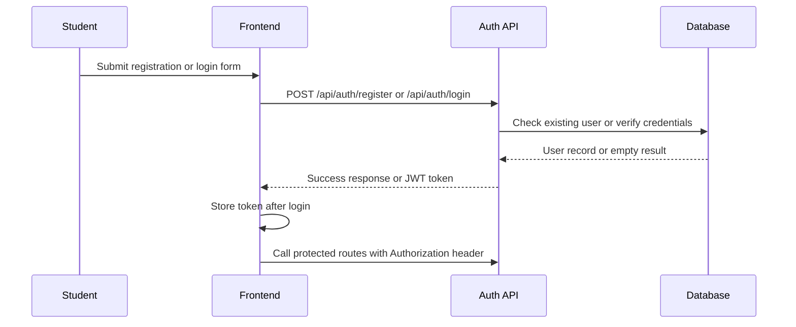

#### UC2. Manage Personal Profile

A student updates name, biography, university association, and avatar. The profile is reused across listings, offers, and rating views.

Flow:

1. The student opens the profile page after authentication.
2. The frontend requests the current profile from the backend.
3. The backend returns the stored profile data for the active user.
4. The student edits fields such as name, biography, and avatar.
5. If the avatar changes, the frontend requests an upload URL and confirms the upload after the file is stored.
6. The backend validates the profile payload and updates the database record.
7. The updated profile is returned and reflected in the UI.

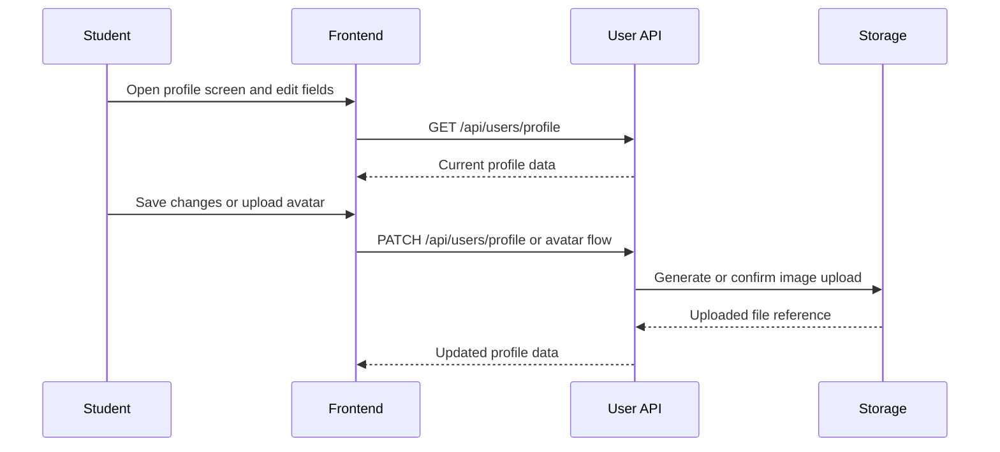

#### UC3. Admin Manage Users

Admins view the user list, open a single user record, update profile fields when needed, soft delete accounts, and restore previously removed accounts.

Flow:

1. The admin opens the user management dashboard.
2. The frontend loads a paginated list of users from the backend.
3. The admin searches, filters, or opens a specific user record.
4. The backend returns the selected user details.
5. The admin edits user data or marks the account as deleted.
6. If needed, the admin restores a previously deleted account.
7. The backend persists the change and returns the updated state.

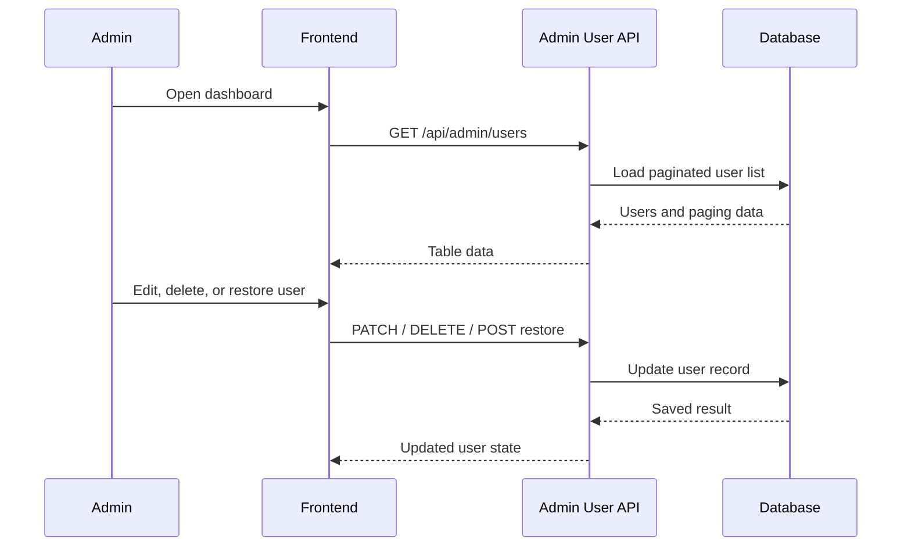

#### UC4. Manage Campus Locations

Admins maintain a trusted set of meetup locations for trade and exchange activities. This reduces uncertainty for physical handoff arrangements.

Flow:

1. The admin opens the location management screen.
2. The frontend requests the current list of campus locations.
3. The admin adds or edits the location name, address, hours, coordinates, or image.
4. The backend validates the input and stores the location record.
5. The admin can deactivate a location when it should no longer be used.
6. The updated list is returned to the frontend.

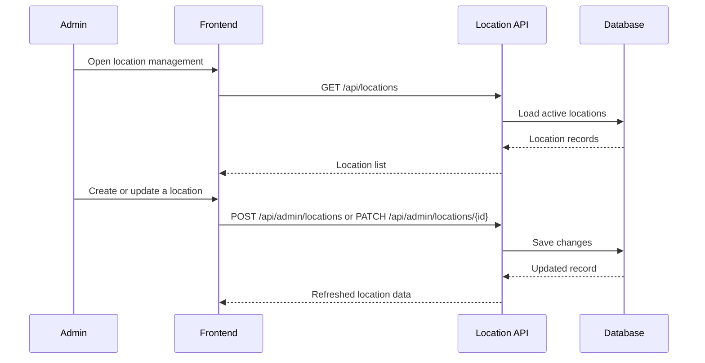

#### UC5. Manage Categories and Attributes

Admins define the item taxonomy and allowed condition/mode tags so listings remain standardized.

Flow:

1. The admin opens category or attribute management.
2. The frontend fetches the existing classification data.
3. The admin creates, edits, or deletes category definitions.
4. The backend validates the data and stores the taxonomy update.
5. Listing forms use the updated category and attribute values.

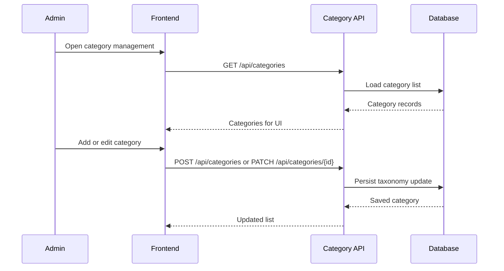

#### UC6. Publish and Maintain Listings

Students create a product listing, upload images, classify it by category, and edit or remove it later if needed.

Flow:

1. The student opens the listing creation form.
2. The frontend loads categories, locations, and other selectable metadata.
3. The student enters the item name, description, type, and status.
4. The student uploads one or more images through the storage flow.
5. The backend stores the item record and links the uploaded images.
6. The student can later edit the listing or hide/delete it if the item is no longer available.
7. The listing appears in search, feeds, and the owner dashboard.

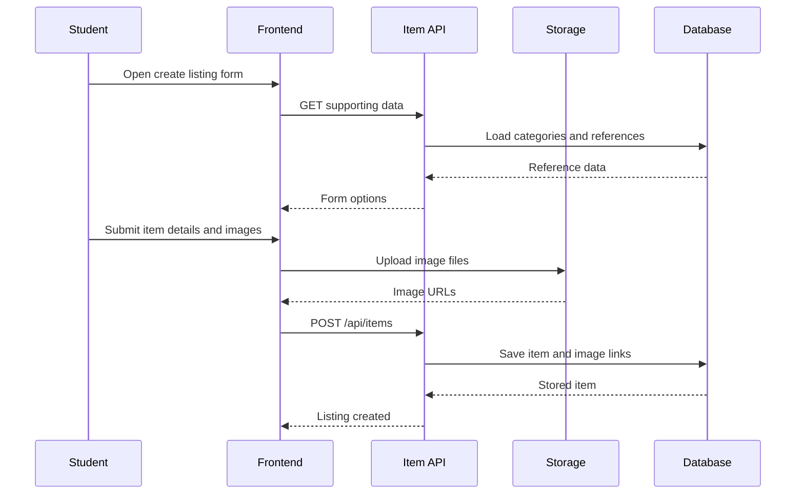

#### UC7. Send Offers and Negotiate

A student initiates an offer for a listing, then the owner reviews the request and moves the transaction through its status stages.

Flow:

1. The interested student opens a listing detail page.
2. The student selects a barter item, cash amount, or both.
3. The frontend submits the offer to the backend.
4. The backend saves the offer with a pending status.
5. The owner reviews incoming offers and accepts or rejects one of them.
6. When one offer is accepted, remaining pending offers can be rejected by service logic.
7. The offer status is returned and shown in both users' histories.

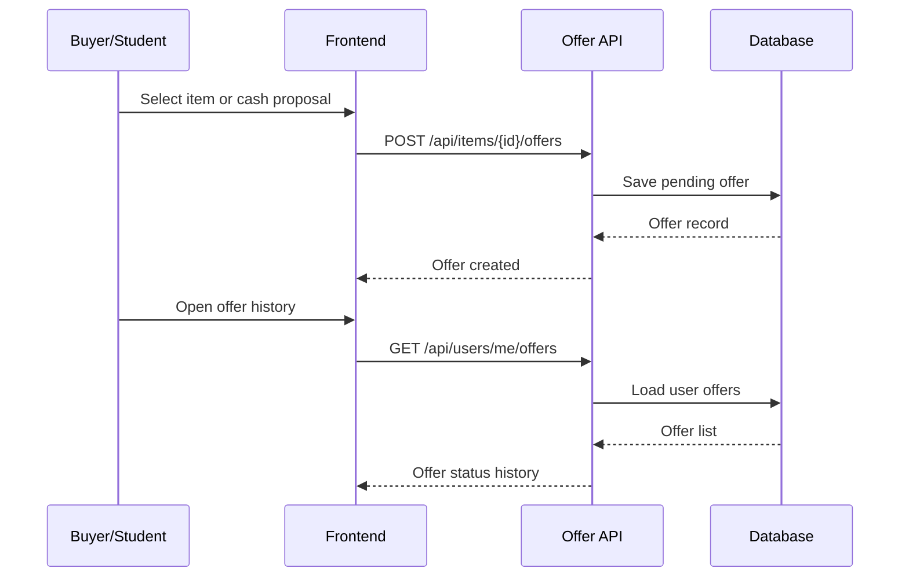

#### UC8. Bid or Settle an Auction

For auction-enabled items, bidders place bids and an admin or owner-side workflow finalizes the result.

Flow:

1. The seller enables auction mode for a listing and configures base price, step price, deposit, and deadline.
2. A bidder opens the auction item and submits a valid bid.
3. The backend checks the auction rules and stores the bid.
4. The system recalculates the current rank or winning position.
5. When the deadline is reached, an admin or settlement process closes the auction.
6. The winning bid is marked and the auction status changes to settled or cancelled.

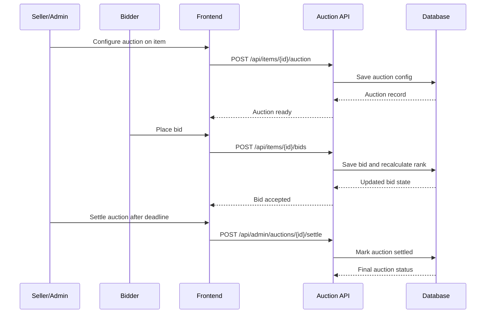

#### UC9. Review Reputation and Statistics

After a completed exchange, participants can observe reputation changes and review their transaction history, while admins inspect aggregated metrics.

Flow:

1. The user opens the personal history or dashboard page.
2. The frontend requests completed transactions, ratings, or statistics.
3. The backend aggregates the data from offers, items, and user records.
4. The frontend displays the transaction history or dashboard cards.
5. Admins use the same underlying data to monitor platform activity and trust signals.

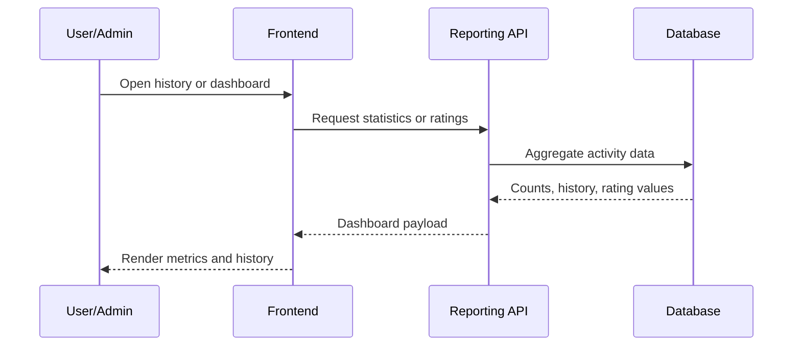

#### UC10. AI Assistant for Location Choosing and Goods Recommendation (Mock)

This is a mock use case for the SP9 direction. A student interacts with an AI assistant to get a suggested meetup location and relevant item recommendations based on conversation context.

Flow:

1. The student opens the AI chat panel from the home page or item detail page.
2. The student asks for help such as finding a safe meetup location or similar items within budget.
3. The AI service extracts intent, entities, and constraints such as preferred area, time window, category, and price.
4. The backend queries candidate locations and listing data that satisfy the extracted constraints.
5. The ranking layer scores options using distance, availability, item relevance, and user history signals.
6. The assistant returns recommended goods and one or more suggested meetup locations with short explanations.
7. The student can select one recommendation, refine the query, or start an offer directly from the result.

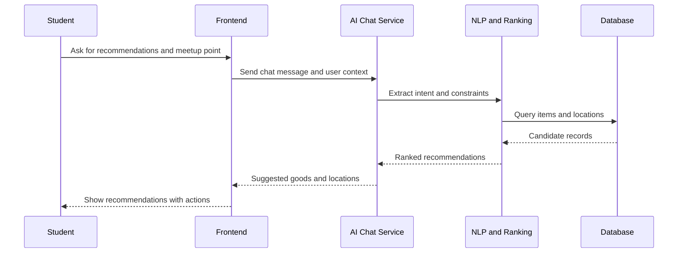

### 5.3 Mermaid Summary

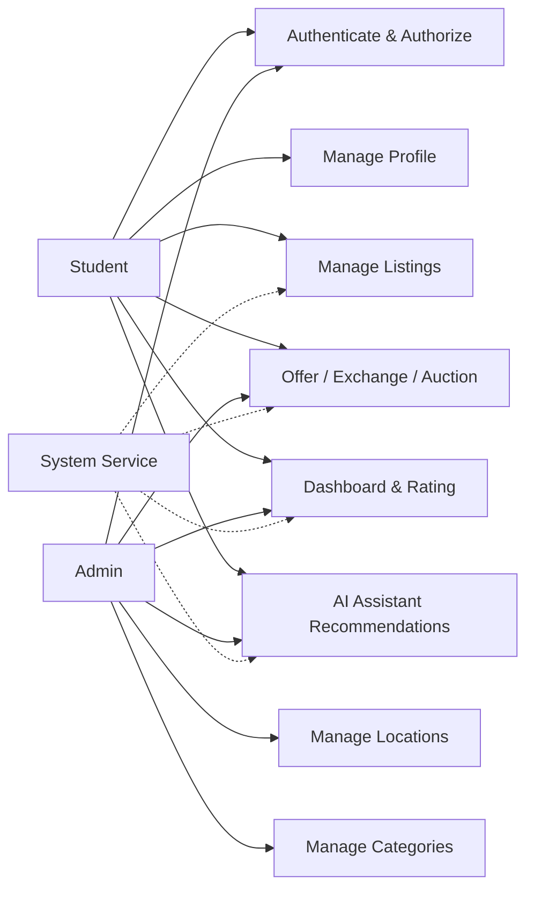

## 6. Database Design

### 6.1 Base Columns from `gorm.Model`

All of the core tables embed `gorm.Model`, so they automatically inherit these standard columns:

- `id` (`uint`): primary key used to identify each record.
- `created_at` (`time.Time`): when the record was created.
- `updated_at` (`time.Time`): when the record was last changed.
- `deleted_at` (`gorm.DeletedAt`): soft-delete marker so data can be hidden without being physically removed.

This is a good fit for the system because marketplace records, moderation actions, and transaction history often need to be traced later instead of being deleted permanently.

### 6.2 Table-by-Table Explanation

#### Universities

| Column | Type | Use case | Why this type |
| --- | --- | --- | --- |
| `name` | `string` | Full university name shown in admin screens and profile relations. | University names are text and can vary in length, so a string is the natural representation. |
| `short_name` | `string` | Abbreviated school name for compact display in UI labels. | Short text is enough and keeps the schema flexible for labels like "HUST" or "UIT". |

This table is used to bind users to a specific campus identity and support school-based registration and filtering.

#### Users

| Column | Type | Use case | Why this type |
| --- | --- | --- | --- |
| `university_id` | `*uint` | Links the user to a university record. | Pointer form allows the field to be nullable when a relationship is not yet assigned. |
| `name` | `string` | Displays the user's real name in profile, listings, and offers. | Names are variable-length text, so a string fits naturally. |
| `email` | `string` | Login identifier and contact address. | Email is text, and string works well with unique indexing and validation. |
| `password` | `string` | Stores the hashed password used for authentication. | Password hashes are textual values, not numeric data, and should never be returned in responses. |
| `avatar_url` | `string` | Points to the uploaded profile image. | URLs are text values and may change depending on storage provider. |
| `is_verified` | `bool` | Marks whether the account has been confirmed. | A yes/no state is best modeled as boolean. |
| `role` | `string` | Distinguishes student and admin access. | A string keeps role handling simple and extensible if more roles are added later. |

This table is the core identity table for authentication, authorization, and profile management.

#### Locations

| Column | Type | Use case | Why this type |
| --- | --- | --- | --- |
| `name` | `string` | Location name such as library, canteen, or dormitory. | Text is the most flexible format for human-readable place names. |
| `description` | `string` | Adds extra notes about the location. | Text allows longer explanations without forcing a rigid structure. |
| `address` | `string` | Stores a readable on-campus address or landmark. | Addresses are textual and may include building names or directions. |
| `image_url` | `string` | Stores a reference image of the meetup point. | The system keeps only the object-storage URL, not the image bytes themselves. |
| `latitude` | `*float64` | Supports map display and location pinning. | Floating-point numbers fit coordinate values with decimal precision, and the pointer makes the field optional. |
| `longitude` | `*float64` | Supports map display and location pinning. | Same reason as latitude; the field can remain empty if coordinates are not available. |
| `open_time` | `string` | Defines when the location becomes available. | A short text time format like `08:00` is simple to store and display. |
| `close_time` | `string` | Defines when the location closes. | A string is enough for time-of-day display without requiring a full timestamp. |
| `is_active` | `bool` | Lets admins enable or disable the location. | Boolean is ideal for active/inactive state. |

This table helps the platform standardize safe meetup points for in-person exchange.

#### Categories

| Column | Type | Use case | Why this type |
| --- | --- | --- | --- |
| `name` | `string` | Stores the category label such as books, electronics, or clothing. | Category labels are textual and should remain easy to edit and localize. |

This table supports item classification and browsing. The many-to-many relationship with items lets one listing appear in multiple relevant categories if needed.

#### Items

| Column | Type | Use case | Why this type |
| --- | --- | --- | --- |
| `name` | `string` | Listing title shown on cards and detail pages. | Titles are variable-length text and should be readable by users. |
| `description` | `string` | Detailed listing content describing the item condition and notes. | Text is appropriate because descriptions can be long. |
| `type` | `ItemType` (string) | Indicates barter or auction mode. | A string-backed enum keeps the values controlled while remaining easy to serialize. |
| `status` | `ItemStatus` (string) | Shows whether the item is available, reserved, traded, or hidden. | A string-backed enum is readable in APIs and easy to validate in services. |
| `user_id` | `uint` | Links the listing to the seller/owner. | A non-null unsigned integer matches the primary key of the user table and cannot be negative. |

This table is the central listing entity for the marketplace. The relation fields for categories, images, and offers are handled by GORM and are not stored as plain scalar columns.

#### Item Images

| Column | Type | Use case | Why this type |
| --- | --- | --- | --- |
| `url` | `string` | Stores the public or signed location of the uploaded image. | Images are kept in object storage, so the database only needs to store the reference URL. |
| `item_id` | `uint` | Links the image to its parent listing. | Unsigned integer fits the foreign key to the item table. |

This table supports multiple photos per listing, which improves trust and product visibility.

#### Offers

| Column | Type | Use case | Why this type |
| --- | --- | --- | --- |
| `offer_user_id` | `uint` | Identifies the student who created the offer. | Foreign keys are stored as unsigned integers because they point to `users.id`. |
| `target_item_id` | `uint` | Identifies the item the student wants to get. | Required foreign key for every offer in the barter flow. |
| `offer_item_id` | `*uint` | Optional item supplied by the offer creator. | Pointer allows null when the offer is cash-only. |
| `cash_amount` | `uint` | Additional money included in the proposal. | Unsigned integer fits a non-negative amount and is simple for current business logic. |
| `offer_message` | `string` | Free-text negotiation note. | Text is appropriate for short comments or conditions attached to the deal. |
| `status` | `OfferStatus` (string) | Tracks whether the offer is pending, accepted, or rejected. | String-backed enum is easy to read in APIs and easy to persist. |

This table is the negotiation record for a barter or buyout request. It is used to manage the proposal lifecycle between the student who sends the request and the owner of the target item.

#### Auction Configurations

| Column | Type | Use case | Why this type |
| --- | --- | --- | --- |
| `item_id` | `uint` | Connects the auction settings to one auction item. | The one-to-one relation is enforced through an unsigned foreign key with a unique index. |
| `base_price` | `uint` | Starting price for the auction. | Money values are non-negative, so unsigned integer is a straightforward fit for the current model. |
| `step_price` | `uint` | Minimum increment between bids. | Same reason as base price; it represents a non-negative value. |
| `deposit_amount` | `uint` | Security deposit that may be reserved before bidding. | A non-negative numeric type is enough for the current auction workflow. |
| `deadline` | `time.Time` | Final time when bidding ends. | A full timestamp is required so the system can compare against the current time precisely. |
| `status` | `AuctionStatus` (string) | Indicates open, settled, or cancelled state. | String-backed status is readable and easy to synchronize across services. |

This table configures auction behavior for a listing and is used by the bidding lifecycle.

#### Bids

| Column | Type | Use case | Why this type |
| --- | --- | --- | --- |
| `auction_config_id` | `uint` | Links the bid to the auction session. | Foreign key to the auction configuration table. |
| `bidder_id` | `uint` | Identifies the student who placed the bid. | Foreign key to the user table, stored as an unsigned integer. |
| `amount` | `uint` | The bid value offered by the bidder. | Bids are non-negative numeric values, so unsigned integer fits well. |
| `deposit_paid` | `bool` | Marks whether the required deposit has been reserved or paid. | Boolean is the clearest way to model a yes/no payment state. |
| `status` | `BidStatus` (string) | Tracks whether the bid is active, won, lost, or forfeited. | String-backed enum is easy to display and process in application logic. |
| `rank` | `int` | Records the bid order, where 1 is the highest. | A signed integer is enough because rank can be recalculated and compared. |

This table stores each bid event, allowing the application to rebuild the auction timeline and determine the winning bidder.

### 6.3 Relationship Design

- One university can have many users.
- One user can create many items.
- One item can have many images.
- One item can belong to multiple categories through the join table managed by GORM.
- One item can have many offers and, optionally, one auction configuration.
- One auction configuration can have many bids.

### 6.4 Mermaid ERD

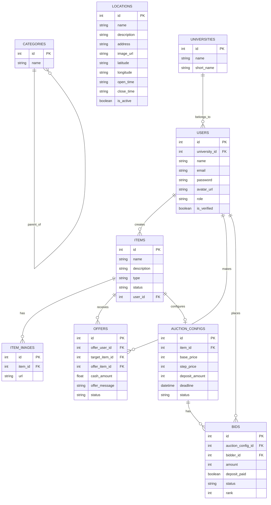

### 6.4 Design Notes

The schema is intentionally modular so the marketplace can evolve by adding more item metadata, transaction records, or AI-related tables without reshaping the current core entities. Soft delete and status columns help preserve auditability for moderation and historical analysis.

## 7. Authentication Flow

### 7.1 Login Sequence

1. The user submits email and password.
2. The backend validates the credentials against the stored user record.
3. If valid, the backend generates a JWT token.
4. The frontend stores the token and attaches it to subsequent API requests.
5. Protected endpoints read the token and load the active user context.

### 7.2 Authorization Rules

- Public routes: login, registration, and general browsing routes that do not require identity.
- Student routes: profile management, listing creation, offers, and personal history.
- Admin routes: moderation dashboards, user administration, category management, and location management.

### 7.3 Mermaid Flow

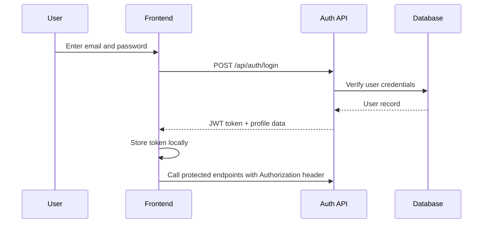

## 8. System Architecture

### 8.1 Layered View

The repository follows a clean domain-oriented architecture:

- Frontend layer: Vue 3, Vite, TypeScript, Pinia, Vue Router, and reusable UI components.
- API layer: typed client and route guards that manage authentication state.
- Backend layer: domain handlers, services, repositories, and middleware implemented in Go.
- Data layer: PostgreSQL for persistent records and object storage for avatars and item images.
- Documentation layer: Swagger JSON and sprint diagrams for traceability.

### 8.2 Backend Organization

Each backend module owns its own handler, service, repository, DTOs, and related model interactions. This keeps the user, item, category, location, offer, and auction domains separated while still sharing common utilities such as auth helpers and standardized API responses.

### 8.3 Frontend Organization

The frontend is organized around views and reusable components. Route guards enforce authentication, while dashboards and forms provide direct access to the marketplace operations. This layout supports rapid expansion without entangling page logic with domain logic.

### 8.4 Mermaid Architecture

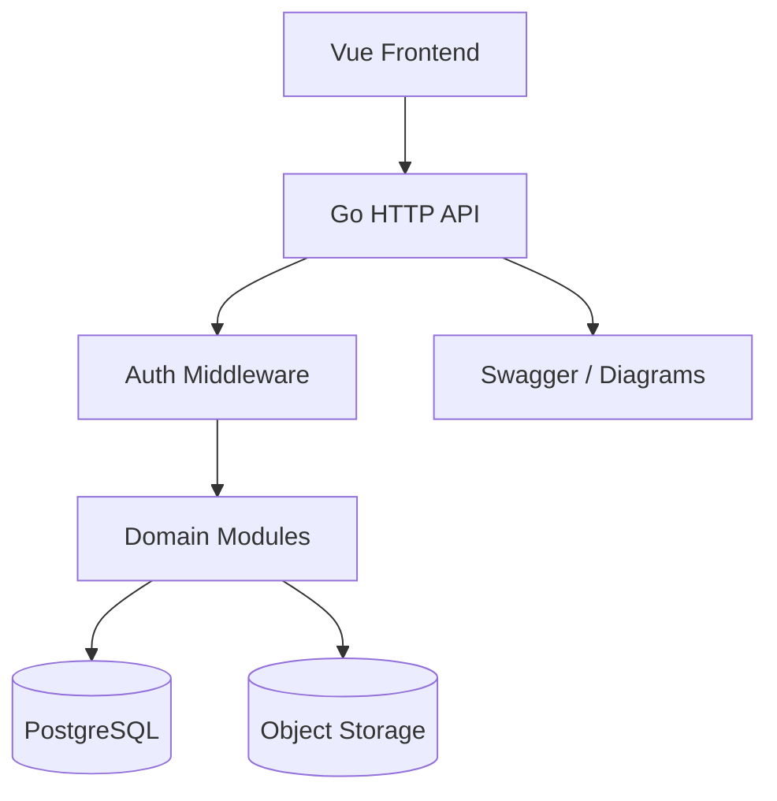

## 9. UI/UX Design

### 9.1 Design Principles

- Keep the main user journeys short, explicit, and easy to complete.
- Use a different interaction pattern for each role: card-based exploration for students and table-based control for administrators.
- Surface validation, loading states, and action feedback immediately so the user always understands the result of an operation.
- Preserve a clear separation between public browsing, private student actions, and admin-only management tasks.

### 9.2 UI/UX Interaction by Use Case and View

#### Authentication Screens: `LoginView` and `SignUpView`

The authentication flow is intentionally minimal. On `SignUpView`, the user enters name, email, password, and password confirmation. The form validates the password pair before submitting the registration request, which reduces avoidable server errors and improves perceived responsiveness. On `LoginView`, the user enters credentials once and receives immediate feedback after authentication succeeds or fails. This design supports the most important usability rule of the project: the user should be able to enter the system with as few steps as possible while still receiving strong feedback about validation and access status.

#### Home and Marketplace Discovery: `HomeView`

`HomeView` serves as the main discovery surface for the marketplace. It presents items in a card-based layout, allowing students to scan product images, names, categories, and statuses quickly. Search and category filtering help the user narrow the catalog without moving away from the page. When the user opens an item, the interface decides whether to show a barter detail panel or redirect to the auction flow if the item is marked as auction-based. This interaction keeps browsing lightweight while still supporting the more complex transaction paths behind the scenes.

#### Product Exploration and Offer Creation: `ItemDetailView`

`ItemDetailView` is the central decision screen for a student who wants to inspect a specific item. The page shows the item title, description, categories, image references, and current status in a structured layout that improves readability. If the item is a normal barter listing, the user can select one of their own items, add an optional cash amount, and send an offer directly from the same screen. If the item is an auction listing, the page changes the primary action into an auction entry point so the user does not accidentally submit the wrong type of request. This conditional behavior reduces confusion and aligns the interface with the underlying business logic.

#### Offer Management: `OffersView`

`OffersView` is split into two tabs: sent offers and received offers. The sent tab lets students review the proposals they created and track whether each one is pending, accepted, or rejected. The received tab supports the seller-side workflow by allowing the owner to choose an item, inspect incoming proposals, and accept or reject them one by one. This tabbed structure is useful because it keeps two related but different mental models in the same space: the student as a negotiator and the student as a listing owner.

#### Transaction Tracking: `TransactionsView`

`TransactionsView` presents settlement records, pending holds, and completed payouts in a dashboard format. The user can search transactions, filter by status, and inspect individual entries without reading raw data directly from the database. This view is especially important for trust and transparency because it gives the user a simple way to verify how value moved through the system, whether through barter, deposit, or settlement events.

#### Appointment Coordination: `AppointmentsView`

`AppointmentsView` supports the scheduling part of the exchange workflow. Each appointment card includes the date, time, location, partner name, and status, making it easy for the student to understand what needs to happen next. A side panel shows a placeholder map and recommended meetup zones, which supports the location-based aspect of the platform. The interaction pattern is intentionally lightweight: the user can scan upcoming meetings, confirm the next action, or reschedule without leaving the page.

#### Bidding and Auction Flow: `BiddingView`

`BiddingView` is designed for the auction-based listing flow. The page emphasizes the auction deadline, current highest bid, minimum next bid, and the ranked bid list so the user can understand the competition at a glance. For sellers, the page also exposes the auction configuration panel where base price, step price, deposit amount, and deadline are entered. For bidders, the main action is to place a bid that satisfies the minimum increment rule. This separation between configuration and participation makes the experience easier to understand for both roles.

#### Inventory Management: `InventoryView`

`InventoryView` is the owner’s workspace for listing creation and maintenance. The form supports item name, description, categories, image URLs, and listing type, and it conditionally reveals auction configuration fields when the user selects an auction item. This reduces interface clutter because auction settings are shown only when they are relevant. The page also supports editing and deleting existing listings, which makes it a practical operational screen rather than a static form.

#### Category Administration: `CategoriesView`

`CategoriesView` provides a straightforward administrative interface for managing the product taxonomy. The page uses a simple card layout with create, edit, and delete actions so that category maintenance can be completed quickly. Because categories are foundational metadata rather than a consumer-facing feature, the interface focuses on clarity and speed instead of visual complexity. This is appropriate for admin work, where the primary goal is to keep the taxonomy accurate and consistent.

#### Administrative Oversight: `dashboard/ManagerUser.vue` and `dashboard/ManagerLocation.vue`

The user management dashboard uses a data-table-first layout because administrative work depends on scanning many records at once. In `ManagerUser.vue`, the admin can inspect the user list, open the edit sheet, change profile fields, or delete an account after confirmation. In `ManagerLocation.vue`, the admin manages campus meetup points through searchable cards, filters, and a form drawer for create or edit actions. These screens are designed around control, auditability, and fast correction rather than exploration.

#### AI Assistance and Recommendation Support: `AiChatView.vue` and `RecommendationsView.vue`

`AiChatView.vue` and `RecommendationsView.vue` represent the SP9 assistance layer. The chat screen gives students a conversational interface for listing drafting, negotiation guidance, safe meetup suggestions, and other intelligent helper tasks. The recommendation screen turns the same idea into a browsable feed with match scores, location hints, and tags, which is helpful when the user prefers structured suggestions over free-form conversation. Together, these views show how the system can support both dialogue-driven and feed-driven discovery.

#### Profile and Account Settings: `settings/Profile.vue` and `settings/ChangePassword.vue`

The settings views support personal account maintenance. The profile page allows the student to update personal information and avatar data, while the change-password page provides a focused flow for credential updates. These screens are intentionally simple because the user’s attention should be on correctness and security, not on visual complexity.

### 9.3 UX Considerations by Sprint

- SP1: authentication, profile editing, and admin user control should remain simple, fast, and reliable.
- SP2: location management should clearly present coordinates, working hours, and active state.
- SP3: category administration should prioritize quick create/edit/delete actions with minimal visual overhead.
- SP4: item attributes and status selection should reduce confusion during listing creation.
- SP5: listing publication should guide the student through images, categories, and item details in a short flow.
- SP6: offers, appointments, and transaction screens should clearly show the current stage and the next action.
- SP7: rating and statistics screens should make history understandable at a glance through cards and filters.
- SP8: sign-in and authorization feedback should be immediate so the user knows why access is allowed or denied.
- SP9: AI chat and recommendation tools should assist the user without blocking the core marketplace workflow.

## 10. Sprint-Based Design Summary

### SP1: Quản lý Người dùng

This sprint establishes the foundation of the platform by creating the user and admin identity model, profile CRUD flows, and the first protected administrative management area. It also defines how the system binds user accounts to university identity data.

### SP2: Quản lý Địa điểm & Khu vực

This sprint introduces authorized meetup locations for on-campus transactions. It adds the administrative layer required to standardize where item exchanges can happen safely.

### SP3: Quản lý Danh mục đồ dùng

This sprint builds the hierarchical catalog structure used to organize items and improve discoverability. It is the basis for filtering, browsing, and consistent item classification.

### SP4: Quản lý Thuộc tính & Trạng thái

This sprint defines the condition and exchange-mode vocabulary for listings. It ensures that users describe items with comparable and structured metadata.

### SP5: Quản lý Sản phẩm

This sprint covers item publication, image upload, home-page presentation, and data flow for active listings. The sprint design also anticipates cache optimization for hot listings, even when the current code focuses on the core CRUD path.

### SP6: Quản lý Giao dịch & Lịch hẹn

This sprint structures the negotiation lifecycle, including offers, bidding, settlement, and schedule coordination. It turns static listings into actionable commerce workflows.

### SP7: Thống kê & Đánh giá

This sprint adds operational visibility and trust signals through dashboards, histories, and ratings. It gives both admins and students a way to measure platform health and transaction quality.

### SP8: Xác thực & Phân quyền

This sprint enforces school-based identity, JWT security, and role separation. It protects the platform from unauthorized access while keeping the user journey straightforward.

### SP9: Tích hợp AI & Hỗ trợ người dùng

This sprint extends the marketplace with intelligent assistance, including image understanding, smart matching, logistics suggestions, and chatbot support. It is the natural next layer after the marketplace core is stable.

## 11. Conclusion

The system is designed as a structured campus marketplace with strong account control, clear admin oversight, and a modular domain architecture. The sprint roadmap expands the platform from foundational identity and catalog management into transaction handling, reputation tracking, and AI-assisted user support. The current repository already supports the central marketplace workflow and is organized in a way that can absorb the remaining planned features with minimal structural disruption.